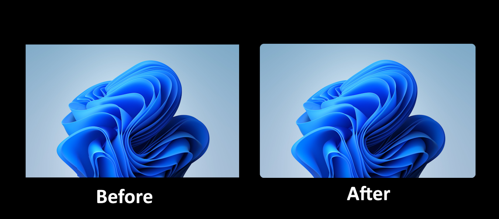

# System-Wide Rounded Corners

A [Windhawk](https://windhawk.net/) mod that gives your displays rounded
corners, like a MacBook screen. The pixels in each corner of every monitor are
covered with pure black, anti-aliased masks, so the whole screen looks like it
has a physical border radius.

## Install

1. Install [Windhawk](https://windhawk.net/) if you don't have it.
2. Open Windhawk, find **System-Wide Rounded Corners** in the Explore tab, and
   click **Install**.

   (Not showing up yet? It may still be pending review. See
   [Development](#development) below for installing it manually in the
   meantime.)

## Features

- **Every monitor:** rounds the corners of every connected display, and
  rebuilds them automatically when monitors are added, removed, rearranged or
  rescaled.
- **Stays out of the way:** the corners are click-through, never take focus,
  and don't show up in Alt+Tab or the taskbar.
- **Cursor goes under the corners:** when the mouse reaches a corner, the
  black mask covers it, like a real rounded display bezel would.
- **Steps aside for fullscreen:** corners disappear on a monitor while a game,
  video or other fullscreen app is showing on it, and come back when you leave
  fullscreen. Other monitors keep theirs. Ordinary maximized windows don't
  count as fullscreen.
- **Clean screenshots:** by default the corners are hidden from screenshots and
  screen recordings, so your captures stay rectangular.
- **Scales with your display:** the radius follows Windows display scaling, so
  it looks the same at 100%, 150% or 200%.

## Settings

| Setting | Default | What it does |
|---|---|---|
| Corner radius (px) | 12 | Radius at 100% display scaling. 10–16 looks closest to a Mac. |
| Scale radius with display scaling | On | At 150% scaling, a 12 px radius becomes 18 px, and so on. |
| Round top corners | On | Turn off to keep the top corners square. |
| Round bottom corners | On | Turn off to keep the bottom corners square, e.g. next to the taskbar. |
| Draw mouse cursor under the corners | On | Hides the cursor behind the mask when it enters a corner, instead of drawing it on top. |
| Hide corners on fullscreen content | On | Removes the corners from a monitor while a game, video or other app is fullscreen on it. |
| Hide corners from screenshots and recordings | On | Turn off if you want the corners to appear in captures. |

All settings apply instantly, no restart needed.

## How it works

- Runs inside the Explorer process that hosts the desktop and taskbar. It
  doesn't hook or patch any Windows functions.
- Each corner is a tiny always-on-top, click-through layered window holding a
  pre-rendered, 4×4 supersampled quarter-circle mask. Nothing is redrawn per
  frame; the compositor handles them like any other window.
- Windows always draws the real cursor above every window, so to get the
  cursor *under* the corners, the mod hides the system cursor while it's in a
  corner area and draws an identical copy just beneath the masks. A low-level
  mouse hook does this before the cursor moves, so the real cursor never
  flashes on top. Away from the corners, the hook only does a couple of
  rectangle checks.
- Fullscreen detection watches the foreground app for resizes and also checks
  what's covering each monitor, so a video left fullscreen on a second monitor
  is detected too.

## Limitations

- The Start menu, Action Center and the Alt+Tab switcher live in a higher
  z-order band than any normal window, so they can draw over the corners while
  they're open.
- Exclusive-fullscreen games bypass the desktop compositor, so the corners
  can't appear there. Borderless-windowed games are detected as fullscreen and
  the corners step aside anyway.
- Inside a corner, animated cursors show only their first frame, and the
  cursor copy may trail the real position by about one frame.
- The cursor copy is never captured, so screen recordings show no cursor while
  it's inside a corner.

## Development

To install the mod manually before it's in the catalog, or to tinker with it:

1. In Windhawk, click **Create a new mod**.
2. Replace the template with the contents of
   [`system-wide-rounded-corners.wh.cpp`](./system-wide-rounded-corners.wh.cpp).
3. Click **Compile Mod**, then **Exit Editing Mode**.

Bug reports and ideas are welcome in [Issues](../../issues).

## License

[MIT](./LICENSE)
